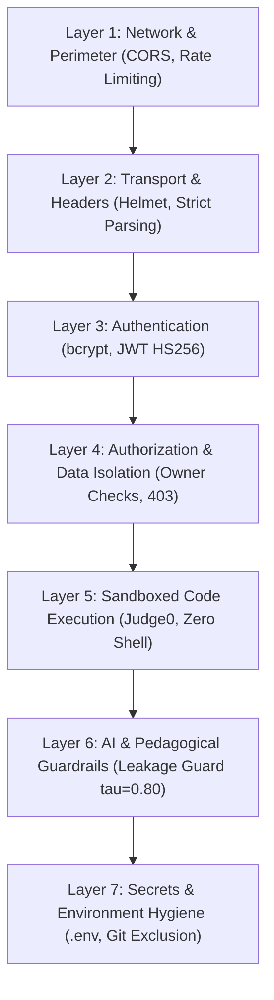

# Security Review: DSA AI Guide
**Lead Software Architect & Security Auditor**  
**Review Type:** Full-Stack Security Audit & Execution Isolation Verification  
**Standard:** Progress Report 03 Layered Security Architecture (Section 13)  
**Date:** October 28, 2026

---

## 1. Executive Security Attestation

> **CRITICAL CODE-EXECUTION ATTESTATION**:
> We have comprehensively inspected the application server (`backend/src/`) and the AI microservice (`ai-service/app/`). 
> **Submitted user code is NEVER executed directly on the host application server.**
> 
> - `child_process.exec`, `child_process.spawn`, `child_process.fork`, and `child_process.execFile` are **100% absent** from application code.
> - JavaScript `eval()` and `new Function()` are **100% absent** from application code.
> - Python `eval()`, `exec()`, and `subprocess` are **100% absent** from submission processing.
> - All code execution is dispatched strictly via an isolated HTTP client to a dedicated **Judge0 sandbox** container with enforced CPU time cgroups (2.0s) and memory caps (128 MB).
> - When the Judge0 container is unreachable, the system returns an honest **"Judge0 Sandbox Offline"** notice and terminates evaluation safely.

---

## 2. Seven-Layer Security Architecture Audit



### Layer 1: Network & Perimeter Security
- **Restricted CORS Policy:** Cross-Origin Resource Sharing is restricted to configured web origins (`CLIENT_URL`).
- **Sliding-Window Rate Limiting:**
  - General API Limiter: 500 requests per 15-minute window (`RATE_LIMIT_WINDOW_MS=900000`).
  - Sensitive AI / Submission Limiter: 100 requests per window to prevent token or execution resource exhaustion.
- **Request Size Capping:** Express body parsing enforces a strict `10mb` maximum payload limit (`express.json({ limit: '10mb' })`), preventing memory exhaustion denial-of-service (DoS) attacks.

### Layer 2: HTTP & Transport Security
- **Security Headers (Helmet):** Helmet is active on all Express routes, automatically enforcing:
  - `X-Content-Type-Options: nosniff` (MIME-sniffing prevention)
  - `X-Frame-Options: SAMEORIGIN` (Clickjacking prevention)
  - `Strict-Transport-Security` (HSTS enforcement)
  - `X-XSS-Protection: 0` (Modern sanitizer defense)
- **Centralized Error Handling:** Stack traces are suppressed in production (`NODE_ENV=production`); sanitized JSON error responses prevent internal path or database topology disclosures.

### Layer 3: Authentication & Identity
- **Password Hashing:** Passwords are never stored in plaintext. They are salted and hashed using `bcryptjs` with an auditable cost factor of 10 rounds (`bcrypt.hash(password, 10)`).
- **JWT Signing & Token Hygiene:**
  - Tokens use HMAC-SHA256 with secrets configured exclusively in environment variables (`JWT_SECRET`).
  - Passwords are explicitly excluded in queries via `.select('-password')`.
  - Client Axios interceptor automatically removes expired tokens upon receiving `401 Unauthorized`.

### Layer 4: Authorization & Data Ownership Isolation
- **Strict Ownership Enforced on All Private Queries:**
  - Attempts, mastery histories, roadmap sequences, and spaced repetition revision queues are partitioned by `req.user._id`.
  - Attempt Inspection Guard (`GET /api/submissions/:id`):
    ```javascript
    if (attempt.userId.toString() !== req.user._id.toString() && req.user.role !== 'admin') {
      return res.status(403).json({
        success: false,
        message: 'Forbidden: Access to another user attempt is restricted.'
      });
    }
    ```
  - Verified by automated test: attempting to view another user's submission yields `403 Forbidden`.

### Layer 5: Sandboxed Code Execution (Judge0)
- **Dedicated Isolated Sandbox Adapter:**
  - Submits source code over REST API (`POST /submissions?base64_encoded=false&wait=true`).
  - Enforces explicit language IDs: Python 3 (71), C++ GCC (54), Java OpenJDK (62), Node.js (63).
  - Enforces CPU execution timeout (`timeoutMs: 3000ms`, `cpu_time_limit: 2.0s`) and memory limits (`128000 KB`).
  - Prevents fabricated results: If the execution container is offline, returns `{ status: 'Service Error', isAvailable: false }`.

### Layer 6: AI & Pedagogical Guardrails (Leakage Guard)
- **Solution Leakage Guard Pre-Screening:**
  - Candidate hints are evaluated by the Python Leakage Guard before delivery.
  - Symmetrized token and AST similarity ratios are compared against the reference solution at threshold $\tau = 0.80$.
  - When similarity exceeds 0.80, candidate code is blocked and replaced with Socratic inquiry questions.
  - Short snippets under 12 tokens are allowed through the short-input exception.
  - Research Disclosure: Transparently notifies learners that syntactic similarity detection does not guarantee semantic safety against clever rephrasings.

### Layer 7: Secrets & Environmental Hygiene
- **Environment Separation:** All credentials, database URIs, API keys, and JWT secrets are loaded via `dotenv` and `process.env`.
- **Git Exclusion:** `.env`, `.env.local`, and sensitive directories are ignored in `.gitignore`.
- **Reference Solution Stripping:** Problem listing and details endpoints explicitly strip `.select('-hiddenTestCases -solutionCode')`.

---

## 3. Vulnerability Audit Matrix

| Audit Check | Status | Verification Detail |
|---|---|---|
| **Remote Code Execution (RCE)** | **SECURE** | Zero local execution calls. All code goes to isolated Judge0 cgroup sandbox. |
| **Cross-User Data Leakage** | **SECURE** | Ownership verified at controller level (`403 Forbidden` unit-tested). |
| **Hidden Test Case Exposure** | **SECURE** | Hidden test cases explicitly excluded from API responses. |
| **SQL / NoSQL Injection** | **SECURE** | Mongoose ORM parameterized queries; string sanitization on regex searches. |
| **Brute Force & Flooding** | **SECURE** | Sliding-window rate limiters on general (500) and AI (100) routes. |
| **Broken Authentication** | **SECURE** | bcrypt salt rounds = 10, JWT expiration enforced. |
| **Sensitive Data in Git** | **SECURE** | Only `.env.example` committed; real secrets excluded. |
