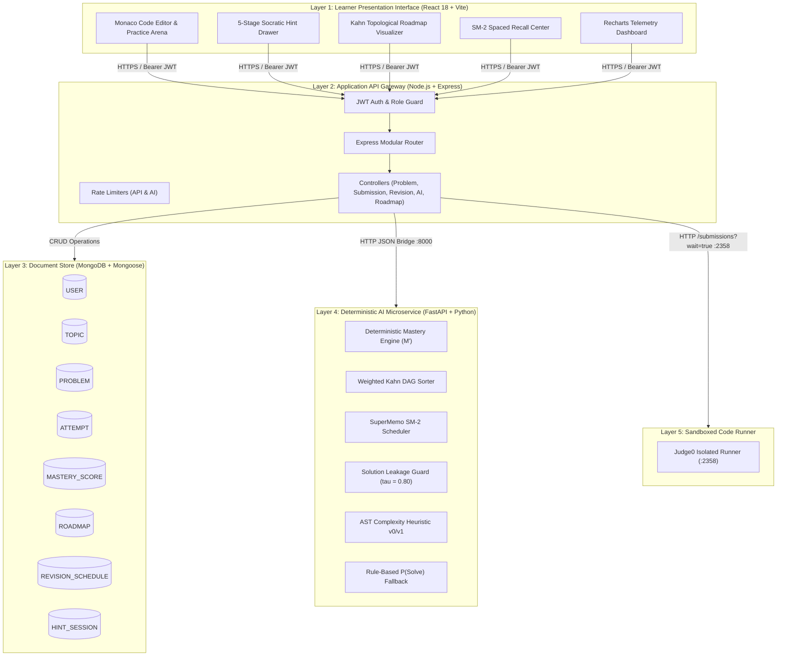
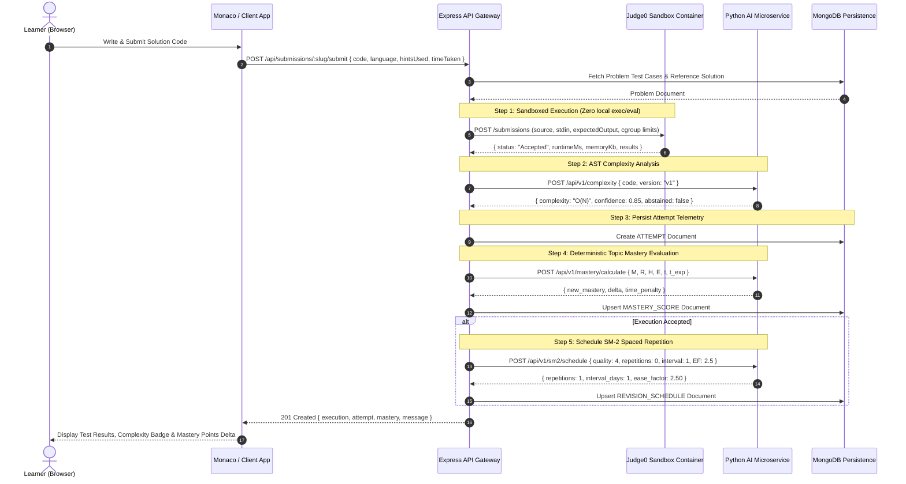
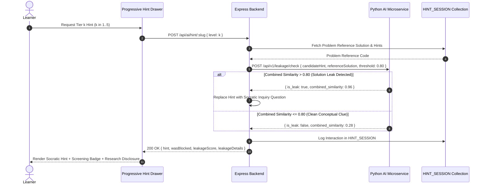

# System Architecture: DSA AI Guide
**GL Bajaj Group of Institutions, Mathura**  
**Authors:** Ayush Parmar, Himanshi Mittal | **Project Guide:** Er. Gopal  
**Document Classification:** Academic Architectural Specification  
**Date:** October 28, 2026

---

## 1. Architectural Philosophy & Layered Isolation

The **DSA AI Guide** platform addresses the core deficiencies of traditional competitive programming platforms: binary non-pedagogical feedback, cognitive overload, rigid curriculum graphs, and the forgetting curve. 

To achieve scientific integrity and deterministic reproducibility, the architecture strictly segregates:
1. **The Deterministic Core (Python 3 / FastAPI):** Mathematical mastery scoring, Kahn topological sort sequencing, SuperMemo SM-2 interval scheduling, AST-based static complexity estimation, and token/AST solution leakage pre-screening.
2. **The Application Platform & Persistence Layer (Node.js / Express / MongoDB):** REST API gateway, JWT authentication, role authorization, rate-limiting, and state persistence across 8 normalized collections.
3. **The Isolated Execution Sandbox (Judge0 REST API Adapter):** Dedicated containerized code runner executing untrusted code with CPU and memory cgroups. No shell `eval()` or `exec()` is ever permitted on the server.
4. **The Adaptive Presentation Interface (React 18 / Vite / Monaco / Recharts):** IDE environment, multi-tier progressive Socratic hints, live telemetry, and topological DAG visualization.

---

## 2. High-Level System Topology

---

## 3. End-to-End Submission & Telemetry Data Flow

---

## 4. Socratic Hint Generation & Solution Leakage Guard

---

## 5. Normalized Database Entities (The 8 Report Collections)

| Collection | Schema File | Primary Indexes | Architectural Invariants |
|---|---|---|---|
| **`USER`** | `User.js` | `_id`, `email` (unique) | Passwords hashed with bcrypt (cost 10). Stores gamification states (XP, streaks, level). |
| **`TOPIC`** | `Topic.js` | `_id`, `slug` (unique) | Corresponds to the 16 IEEE prerequisite graph topics rooted at Complexity Analysis. |
| **`PROBLEM`** | `Problem.js` | `_id`, `slug` (unique), `topicSlug` | Stores problem statement, constraints, optimal bounds, sample test cases, hidden test cases (never exposed to client), and 5-tier hints. |
| **`ATTEMPT`** | `Attempt.js` | `_id`, `userId`, `problemSlug`, `status` | Auditable log of all submissions with Judge0 runtime ms, memory, and mastery delta. |
| **`MASTERY_SCORE`** | `MasteryScore.js` | `_id`, `userId + topicSlug` (unique) | Clamped mastery score $M \in [0, 100]$ computed via $M' = \text{clamp}(M + 8R - 2H + 3E - T, 0, 100)$. |
| **`ROADMAP`** | `Roadmap.js` | `_id`, `userId` (unique) | Topological sequence of the 16 topics generated by weighted Kahn algorithm. |
| **`REVISION_SCHEDULE`** | `RevisionSchedule.js` | `_id`, `userId + problemSlug` (unique) | SuperMemo SM-2 state: repetitions $n$, interval days $I$, and ease factor $EF \ge 1.30$. |
| **`HINT_SESSION`** | `HintSession.js` | `_id`, `userId`, `problemSlug`, `level` | Audit trail of hints served, similarity scores, and leakage block flags. |

---

## 6. Security & Execution Isolation Mandate

1. **Zero Shell Execution**: User code is sent strictly over HTTP to Judge0 running in an isolated container. The application server never executes `child_process.exec`, `eval()`, or `new Function()`.
2. **Access Isolation**: Learner attempts, mastery scores, and revision queues enforce strict ownership checking (`req.user._id === attempt.userId`). Cross-user snooping returns `403 Forbidden`.
3. **No Solution Leaks**: Hidden test cases and reference solutions are explicitly stripped (`.select('-hiddenTestCases -solutionCode')`) before problem objects leave the API gateway.
