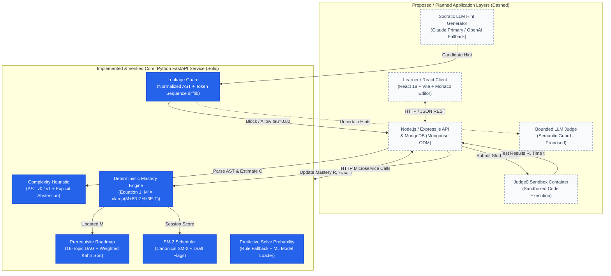
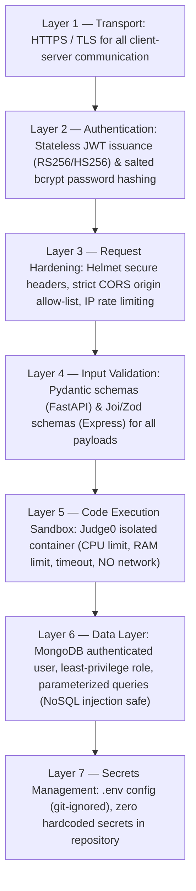

# System Architecture: DSA AI Guide
**Lead Software Architect & Senior Python Engineer**  
**Document Reference:** Progress Report 03 (Section 10 & 13) & IEEE Research Paper (Figure 1 & Section 3)  
**Date:** October 27, 2026

---

## 1. Architectural Overview & Component Boundary

DSA AI Guide decouples **quantitative, deterministic pedagogical assessment** from **qualitative generative tutoring**. All quantitative learner state transitions (mastery scoring, roadmap sequencing, spaced review scheduling, syntactic leakage blocking, and static complexity estimation) are strictly computed by deterministic Python algorithms, guaranteeing auditable, reproducible outputs.

### Architecture Diagram (Figure 1 Alignment)

---

## 2. Core Evaluation & Tutoring Workflow

1. **Attempt Submission**: The learner writes a solution in the Monaco Code Editor and submits it via the React client.
2. **Execution & Static Analysis**:
   - The submission is evaluated by the code execution engine (Judge0) against functional test cases, returning result $R \in \{+1, +0.5, -1\}$ and execution time $t$.
   - Concurrently, the Python AI microservice inspects the AST via `estimate_time_complexity(code, version="v1")` to determine algorithmic time complexity or trigger explicit abstention if hidden-cost operations are found.
3. **Deterministic Mastery Update**:
   - The Deterministic Mastery Engine evaluates:
     $$M' = \text{clamp}\left(M + 8R - 2H + 3E - T, \, 0, \, 100\right)$$
   - Where $H$ is the hints consumed, $E$ denotes whether complexity efficiency was met, and $T = \text{clamp}\left(\frac{t/t_{exp} - 1}{2}, 0, 1\right)$ is the normalized time penalty.
4. **Dynamic Roadmap Sequencing**:
   - Upon mastery update, the Prerequisite DAG is processed via weighted Kahn's algorithm:
     Among all topics with satisfied prerequisites, the one with lowest mastery ($1 - M/100$) is placed first, breaking ties alphabetically.
5. **Spaced Repetition Review (SM-2)**:
   - For retained topics, the SM-2 engine computes the next review date based on recall quality $q \in [0, 5]$, updating repetitions $n$ and interval $I \in \{1, 6, \lceil I \times EF \rceil\}$.
6. **Leakage-Guarded Hint Delivery**:
   - When a struggling learner requests guidance, candidate hints are screened by the Leakage Guard before delivery.
   - If normalized syntactic similarity to the reference solution satisfies $\text{sim} \ge 0.80$ (and token count $\ge 12$), the hint is blocked to prevent solution exposure.

---

## 3. Microservice API Contract (Express Backend $\leftrightarrow$ FastAPI AI Service)

The Express backend calls the Python FastAPI service over internal HTTP (`http://localhost:8000/api/v1`):

| Endpoint | Method | Request Payload | Response Payload | Description |
|---|---|---|---|---|
| `/mastery/calculate` | `POST` | `{ current_mastery, result, hints_used, is_efficient, actual_time, expected_time, gated_efficiency }` | `{ new_mastery, mastery_change, r_component, h_component, e_component, t_penalty, gated_applied }` | Closed-form mastery scoring |
| `/roadmap/generate` | `POST` | `{ mastery_scores: { topic: score }, custom_graph? }` | `{ roadmap: [topic_names], total_topics, prerequisites_valid }` | Weighted Kahn roadmap generation |
| `/roadmap/validate` | `POST` | `{ graph: { topic: [prereqs] } }` | `{ is_valid, message, errors: [] }` | In-degree & cycle DAG validation |
| `/sm2/next-schedule` | `POST` | `{ quality, repetitions, interval_days, ease_factor, update_ef_on_failure, ef_before_interval }` | `{ quality, repetitions, interval_days, ease_factor, next_review_days, is_successful, ef_delta }` | Spaced repetition interval calculator |
| `/leakage/check` | `POST` | `{ candidate_hint, reference_solution, threshold, min_tokens }` | `{ is_leak, combined_similarity, token_similarity, ast_similarity, raw_similarity, token_count, threshold, used_fallback, is_short_input, explanation }` | Syntactic solution leakage guard |
| `/complexity/estimate` | `POST` | `{ code, version, abstain_on_hidden_costs }` | `{ complexity, version, loop_depth, has_halving_loop, has_sort, is_recursive, recursive_branch_factor, hidden_costs, abstained, confidence, explanation }` | AST complexity & abstention |
| `/predict/solve-probability`| `POST` | `{ user_overall_score, topic_mastery, problem_difficulty, past_attempts, avg_solve_time_sec, hint_count, pattern_familiarity, days_since_last_practice }` | `{ probability, will_solve, model_used, confidence }` | Cold-start rule-based or trained model inference |

---

## 4. Layered Security Architecture (Figure 5 Alignment)

---

## 5. Database Schema Architecture (Mongoose Collections)

As specified in Progress Report 02 & 03, the application persistence layer utilizes 8 relational MongoDB collections:
1. `User`: `_id`, `email`, `passwordHash`, `role`, `overallScore`, `createdAt`
2. `Topic`: `_id`, `name`, `slug`, `category`, `prerequisites: [ObjectId]`, `orderIndex`
3. `Problem`: `_id`, `title`, `topicId`, `difficulty` (Easy/Medium/Hard), `expectedTimeSeconds`, `referenceSolution`, `testCases: [{ input, expectedOutput }]`
4. `Attempt`: `_id`, `userId`, `problemId`, `topicId`, `code`, `result` (+1, +0.5, -1), `solveTimeSeconds`, `hintsUsed`, `isEfficient`, `createdAt`
5. `MasteryScore`: `_id`, `userId`, `topicId`, `score` (0–100), `lastUpdated`, `history: [{ score, change, timestamp }]`
6. `Roadmap`: `_id`, `userId`, `sequence: [topicId]`, `currentTopicIndex`, `generatedAt`
7. `RevisionSchedule`: `_id`, `userId`, `topicId`, `repetitionCount`, `intervalDays`, `easeFactor`, `nextDueDate`, `history: []`
8. `HintSession`: `_id`, `userId`, `problemId`, `attemptId`, `level` (1–5), `candidateHint`, `leakageScore`, `wasBlocked`, `timestamp`
